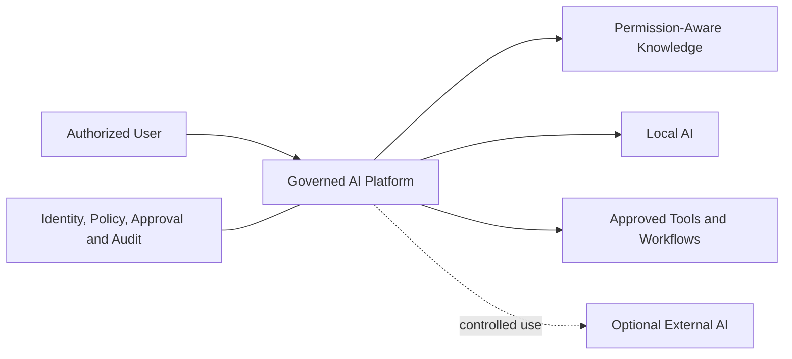
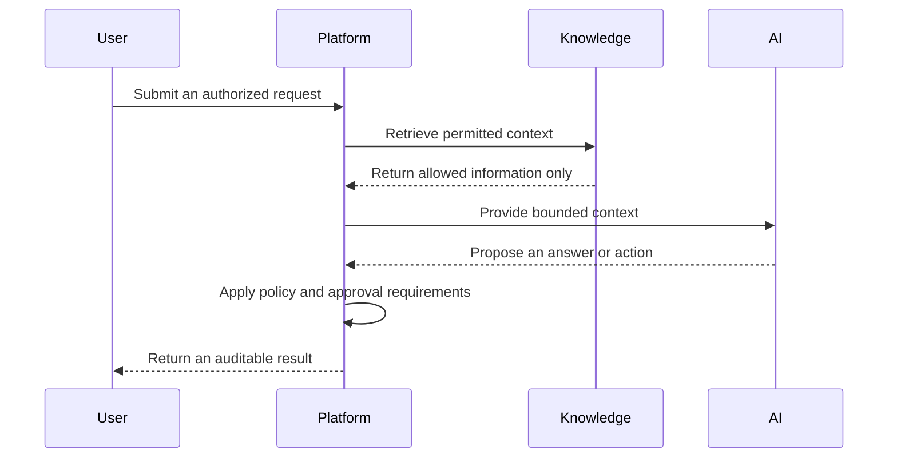

# Local-First Enterprise AI Platform

> Governed AI for organizations that need useful automation without giving up control of sensitive knowledge.

This project is a runnable local-first AI infrastructure MVP built to explore a practical question: how can an organization use retrieval, tools and AI workflows while keeping access, approvals and external model use under explicit control?

This public page intentionally presents product capabilities and design principles only. Source code and proprietary implementation details remain private intellectual property.

## The problem

Organizations want AI systems that can answer questions, retrieve internal knowledge and perform useful actions. Standard AI applications can create difficult governance problems:

- Sensitive context may be sent to services outside the organization's control.
- Retrieval may return information a user is not permitted to access.
- Model-generated actions may run without sufficient review.
- It may be difficult to explain who requested an operation and why it was allowed.

## The product idea

The platform combines local AI execution with a governed control layer. It is designed to make identity, authorization, approvals and auditability part of the system around the model rather than relying on prompt instructions alone.

## Core capabilities

### Permission-aware knowledge access

The platform retrieves context according to the requesting user's permissions. Access control is applied as part of the retrieval path so protected information is not intentionally passed to the model for unauthorized requests.

### Local-first AI

Sensitive workflows can use locally operated models. External AI access is limited to explicitly permitted scenarios and remains subject to governance controls.

### Governed tools and agent workflows

The system supports tool calling and multi-step workflows while keeping sensitive actions behind authorization, approval and audit boundaries.

### Human oversight

Operations that require additional authority can pause for human review. Approval is treated as an explicit system decision rather than an informal chat response.

### Auditability

Important decisions and operations are designed to produce an accountable record, supporting investigation and future operational governance.

## Example workflow

## Safe public demonstration

The public demo should use fictional users and synthetic documents only. It can show:

1. An authorized user receiving a grounded answer from permitted knowledge.
2. An unauthorized request returning no protected information.
3. A sensitive action pausing for explicit human approval.
4. An external-AI request being allowed or rejected according to the workflow's governance state.

The demo must not contain real documents, names, credentials, logs, filesystem paths, configuration values, voice recordings or internal implementation details.

## Technology overview

- Go and Python services
- PostgreSQL and pgvector
- Local LLM inference through Ollama
- Protobuf-based service contracts
- Native macOS interface and local voice interaction

These technologies describe the engineering stack. Detailed component boundaries, security mechanisms and deployment configuration are intentionally omitted.

## Product principles

- **Local-first:** private organizational context should remain locally controlled by default.
- **Permission-aware:** retrieval should respect the requester's access rights.
- **Governed execution:** model output alone should not authorize sensitive actions.
- **Human control:** higher-risk operations should support explicit review and approval.
- **Auditable behavior:** consequential operations should be attributable and explainable.
- **Fail safely:** missing authorization or approval should not produce privileged access.

## Current status

The project is a runnable engineering MVP and product prototype. It demonstrates the primary user experience and governance concepts while remaining under active development.

Future product work may include production identity integrations, deployment hardening, administration tooling, monitoring and organization-specific policy configuration.

## Intellectual property and privacy

- The implementation repository and development history remain private.
- Detailed threat models, enforcement mechanisms and operational configuration are not published.
- Public demonstrations use synthetic identities and generated documents.
- Screenshots and recordings are reviewed for personal information and hidden metadata.
- Public materials explain product value without disclosing proprietary implementation details.

For evaluation or collaboration, a controlled private demonstration can be provided without distributing the source code.
