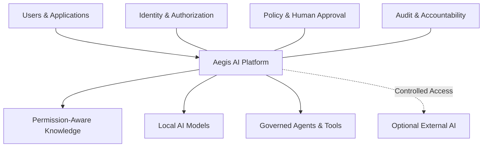
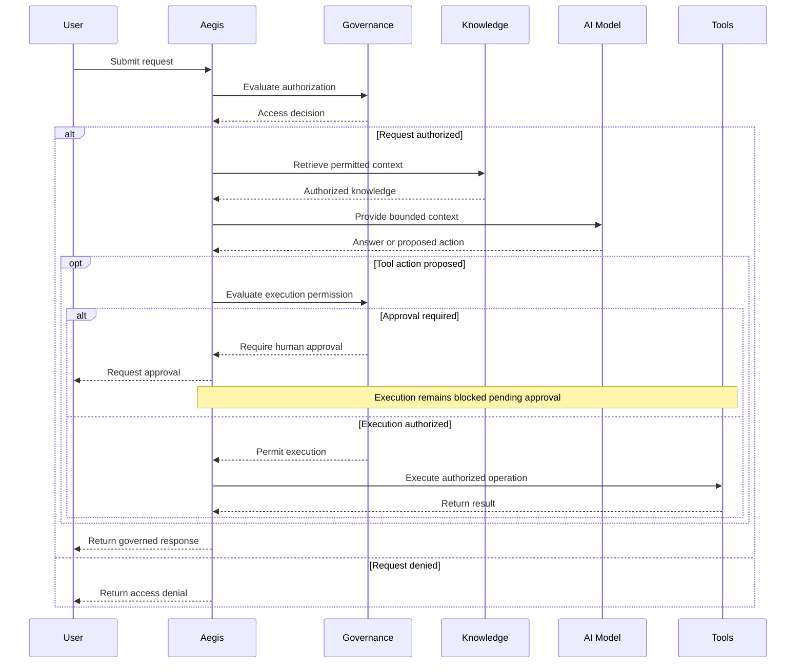

# Aegis — Local-First Enterprise AI Platform

**AI Infrastructure · Permission-Aware RAG · Governed Agents · Local & External LLMs**

> Governed AI infrastructure for organizations that want intelligent automation without giving up control of sensitive knowledge, permissions, and system operations.

**Status:** Runnable Engineering MVP · Active Development  
**Implementation:** Private / Proprietary  
**Focus:** AI Infrastructure · Backend Engineering · Security · Agentic AI

---

## Overview

Aegis is a modular, local-first AI infrastructure platform designed to connect AI models, organizational knowledge, applications, and automation tools under a unified governance framework.

The project explores a fundamental engineering challenge:

**How can organizations use powerful AI capabilities while maintaining explicit control over sensitive information, model access, and automated actions?**

Rather than building another standalone chatbot, Aegis treats AI as an infrastructure capability that can be shared across applications and workflows.

The platform brings together:

- **Local and external AI models** — Flexible AI integration with controlled external access.
- **Permission-aware knowledge retrieval** — Retrieval-augmented generation (RAG) designed around user authorization.
- **Governed agents and tools** — AI-assisted workflows with explicit execution boundaries.
- **Human approval** — Additional authorization for sensitive operations.
- **Auditable workflows** — Traceable decisions and operational accountability.
- **Unified AI experience** — A local application for interacting with multiple AI capabilities.

### Core Architectural Principle

**AI reasoning and system authority must remain separate.**

An AI model may generate an answer, propose an action, or request a tool.

The surrounding infrastructure determines whether the information may be accessed and whether the requested operation is permitted.

This approach reduces reliance on prompt instructions as the sole mechanism for enforcing security boundaries.

**Repository scope:** This public repository provides product and engineering documentation only. Source code and proprietary implementation details remain private.

---

## The Problem

Organizations increasingly use AI to answer questions, retrieve internal information, generate code, and automate operational workflows.

However, integrating AI into sensitive environments introduces several challenges.

### Sensitive Data Exposure

Confidential organizational context may be transmitted to external AI services without appropriate authorization.

### Unauthorized Knowledge Access

Retrieval systems may return information beyond the requesting user's access rights.

### Uncontrolled Agent Execution

AI-generated tool calls may initiate operations without sufficient validation, authorization, or review.

### Fragmented AI Integration

Organizations may depend on multiple AI models, providers, and applications without consistent policies governing their behavior.

### Limited Accountability

It can be difficult to explain which information an AI system accessed, why a particular tool was invoked, or whether an operation was authorized.

**Aegis explores a unified infrastructure approach to addressing these challenges.**

---

## Platform Architecture

Aegis is designed as an intermediary infrastructure layer between users, AI models, organizational knowledge, and executable tools.

The architecture aims to provide consistent governance across AI interactions, regardless of which application, model, or tool is involved.

The diagram represents conceptual platform responsibilities rather than private internal service boundaries.

---

## Core Capabilities

### 1. Permission-Aware Knowledge Retrieval

Aegis combines retrieval-augmented generation (RAG) with authorization-aware access boundaries.

The objective is to retrieve relevant organizational knowledge without exposing information that the requesting user is not permitted to access.

Key capabilities and design goals include:

- Semantic search across indexed knowledge.
- User- and role-aware retrieval boundaries.
- Context selection according to applicable permissions.
- Controlled delivery of retrieved information to language models.
- Grounded answers using authorized knowledge sources.

**Example**

Two employees ask the same question about an internal incident.

An authorized employee may receive an answer based on permitted documents.

An employee without sufficient permissions should not receive protected information.

The intended enforcement boundary exists outside the language model rather than depending on the model to obey confidentiality instructions.

### 2. Local-First AI Execution

Aegis integrates locally operated language models to support AI processing within controlled environments.

Its model integration approach is designed around:

- Local LLM inference.
- Flexible model selection.
- Different model capabilities and workloads.
- Reduced dependency on external AI providers.
- Optional integration with external models.

External AI can be used when permitted by the applicable governance rules.

**Local-first does not mean external AI is prohibited. It means external processing is a controlled choice rather than an unavoidable dependency.**

### 3. Governed AI Agents and Tools

Aegis supports AI-assisted workflows involving tools and multi-step operations.

The platform is designed to distinguish between an AI model proposing an action and the system authorizing its execution.

Governance concepts include:

- Controlled tool invocation.
- Authorization-aware execution.
- Restrictions on sensitive operations.
- Approval requirements for higher-risk actions.
- Traceable workflow decisions.

This separation is important because a model-generated instruction should not automatically grant permission to access resources or perform privileged operations.

### 4. Human-in-the-Loop Approval

Certain operations may require explicit human authorization before execution.

Aegis incorporates approval-gated workflow concepts that allow sensitive actions to pause for review.

Potential scenarios include:

- Access to protected organizational information.
- Operations requiring elevated privileges.
- Sensitive changes to internal resources.
- External interactions requiring additional approval.

Human approval is treated as a system-level authorization decision rather than an informal confirmation generated by the model.

### 5. Controlled External AI Integration

Organizations may benefit from external AI providers for specialized reasoning, coding assistance, and other workloads.

Aegis is designed to make external AI access subject to governance controls.

Relevant considerations include:

- Whether external processing is permitted.
- Which information may be shared.
- Which model or provider is eligible.
- Whether additional authorization is required.
- How the interaction is recorded.

The long-term goal is to allow organizations to benefit from different AI providers without automatically exposing their private knowledge.

### 6. Auditability and Accountability

Aegis treats accountability as an important infrastructure concern.

The platform's design emphasizes traceable decisions involving:

- Request context.
- Authorization outcomes.
- Knowledge access decisions.
- Tool execution permissions.
- Human approval requirements.
- Significant workflow results.

These concepts support investigation, debugging, and future operational governance.

---

## Example: Governed AI Workflow

The following sequence illustrates a conceptual request lifecycle.

This diagram communicates the intended governance model and does not disclose internal implementation details.

---

## Application Experience

Aegis is being developed as an integrated AI environment, combining backend infrastructure with an accessible local application.

The product direction includes several complementary capabilities.

### Conversational AI

A unified interface for interacting with local and supported external language models.

### Knowledge-Assisted AI

Context-aware assistance based on information available within authorized knowledge boundaries.

### AI-Assisted Development

Coding-oriented AI workflows, including code generation, assistance, and completion.

### Agent-Based Automation

Multi-step workflows combining AI models with controlled tools and execution permissions.

### Local Voice Interaction

Voice-enabled interaction through the native application environment.

### Modular AI Capabilities

A foundation for integrating additional models, tools, and specialized capabilities.

These capabilities are intended to operate within a shared governance framework rather than as disconnected applications.

---

## Technology Stack

Aegis brings together backend services, AI inference, retrieval systems, data infrastructure, and native application development.

| Area | Technologies |
|---|---|
| Backend Services | Go, Python |
| AI Inference | Ollama, Local LLMs |
| Knowledge Retrieval | RAG, Embeddings |
| Database & Vector Search | PostgreSQL, pgvector |
| Service Contracts | Protocol Buffers (Protobuf) |
| Application Interface | Native macOS |
| Development Platforms | macOS, Linux |
| Engineering Concepts | APIs, Concurrency, Authorization, Service Integration, Agent Workflows |

The stack is presented at a high level. Internal component boundaries, security mechanisms, and operational configuration are intentionally omitted.

---

## Engineering Highlights

Aegis is an end-to-end engineering project spanning multiple areas of software development.

### AI Infrastructure Engineering

Integrating AI models, inference environments, knowledge retrieval, and application workflows into a coherent platform.

### Backend Development

Developing services that coordinate requests, data access, model interactions, and workflow execution.

### Security-Oriented Architecture

Designing authorization boundaries around information retrieval, model access, and AI-generated operations.

### Agent and Tool Orchestration

Exploring controlled execution flows where model-generated actions are evaluated independently of the model.

### Cross-Technology Integration

Connecting Go and Python services, AI inference infrastructure, database technologies, and a native application interface.

### End-to-End Engineering Ownership

The project covers architecture, implementation, integration, debugging, testing, and continued product development.

**Engineering objective:** Build reliable, modular, and extensible AI infrastructure with explicit trust and execution boundaries.

---

## Illustrative Use Cases

The following scenarios illustrate the platform's intended behavior and governance principles.

They are conceptual examples, not publicly hosted demonstrations or independently verified security guarantees.

### Use Case 1 — Authorized Knowledge Access

An authorized employee asks about a fictional internal incident.

The platform retrieves information within the employee's permissions and generates a grounded answer.

### Use Case 2 — Unauthorized Knowledge Access

Another employee submits the same request without the required permissions.

Protected information should not be included in the retrieved context or generated response.

### Use Case 3 — Human Approval for Sensitive Actions

An AI agent proposes an operation requiring additional authority.

The workflow should pause until the necessary approval is granted.

### Use Case 4 — Controlled External AI Access

A workflow requests processing by an external AI service.

The platform evaluates whether the external interaction and the proposed information sharing are permitted.

These examples describe the intended governance model and can be used as scenarios for continued testing and validation.

---

## Product Principles

### Local-First

Sensitive information should remain within organizationally controlled environments by default.

### Permission-Aware

Knowledge access should respect the permissions of the requesting identity.

### Separation of Reasoning and Authority

AI models may generate recommendations and propose operations, but the surrounding infrastructure determines what may be executed.

### Governed Execution

Sensitive operations should satisfy explicit authorization and approval requirements.

### Human Oversight

Higher-risk workflows should support review and approval before execution.

### Model Independence

Different AI models and providers should be integrable without redesigning the entire governance framework.

### Extensibility

Additional tools, agents, and specialized capabilities should be incorporable through controlled interfaces.

### Auditability

Consequential operations should be attributable and reviewable.

### Fail-Safe Defaults

Missing authorization or required approval should not result in privileged access or execution.

---

## Current Development Status

**Stage: Runnable Engineering MVP — Active Development**

Aegis is a working engineering prototype focused on local-first AI integration, knowledge retrieval, application experience, and governance-oriented workflows.

The project explores how multiple AI technologies can be combined into a unified platform with explicit access and execution boundaries.

The MVP is under active development and should not be interpreted as a production-certified enterprise security product.

### Development Priorities

Current engineering priorities include:

- Strengthening permission-aware knowledge retrieval.
- Validating authorization and execution boundaries.
- Improving governed agent and tool workflows.
- Expanding local and external model integration.
- Improving reliability, testing, and observability.
- Refining the native application experience.
- Evaluating organizational deployment requirements.

Some capabilities described in this README represent ongoing development or intended system behavior rather than completed, independently validated functionality.

---

## Long-Term Vision

Aegis is intended to evolve beyond a standalone AI application.

The broader vision is to establish a **modular AI infrastructure layer connecting AI models, organizational knowledge, applications, and agents under a common governance framework.**

Instead of requiring every AI application to independently manage permissions, model access, and tool execution, Aegis aims to provide reusable infrastructure for these responsibilities.

### Unified AI Infrastructure

A shared foundation for accessing and managing AI capabilities across different applications and workflows.

### Modular Model Integration

Organizations could select local models, external providers, and specialized AI engines according to their requirements.

### Agent and Tool Ecosystem

Third-party developers and organizations could integrate approved agents, tools, and capabilities through controlled interfaces.

### Organization-Controlled AI

Organizations could configure knowledge boundaries, model usage policies, workflow permissions, and approval requirements.

### Deeper Platform Integration

Future development may explore integration with operating systems, enterprise software, and development environments.

### Governance Across Applications

The long-term objective is to apply consistent security and execution principles even when AI interactions originate from different applications or services.

**The vision is to make AI a governed infrastructure capability rather than a collection of disconnected, independently controlled applications.**

These directions represent future product ambitions rather than completed production capabilities.

---

## Intellectual Property and Privacy

Aegis is an independently developed project with a privately maintained implementation.

**This public repository contains product-level documentation only.**

No application source code, executable binaries, screenshots, recordings, or internal implementation materials are publicly available.

The following remain private:

- Source code and development history.
- Proprietary implementation and architectural details.
- Security mechanisms and internal threat models.
- Operational configuration and deployment information.
- Internal technical documentation and testing infrastructure.
- Private datasets, credentials, and operational records.

Public documentation is intended to communicate the project's engineering scope, product capabilities, and long-term vision without disclosing proprietary intellectual property.

This repository does not grant a license to use, reproduce, or distribute the private Aegis implementation.

For technical evaluation or potential collaboration, a controlled private demonstration may be arranged without distributing source code.

---

## Project & Developer

Aegis is an independently developed AI infrastructure project exploring how modern AI capabilities can be integrated into reliable, extensible, and security-conscious software systems.

The project combines practical work in backend engineering, AI integration, data infrastructure, authorization-aware architecture, and end-to-end software development.

**Engineering Interests:** C/C++ · Linux Systems · Go · Python · AI Infrastructure · Backend Engineering · Security · Distributed Systems

**Portfolio:** https://danielsal97.github.io

**GitHub:** https://github.com/danielsal97

---

*Developed as an ongoing engineering and product exploration project. Public documentation describes the project's engineering scope, current development areas, and future direction. Capabilities and architecture may evolve as implementation and validation progress.*
